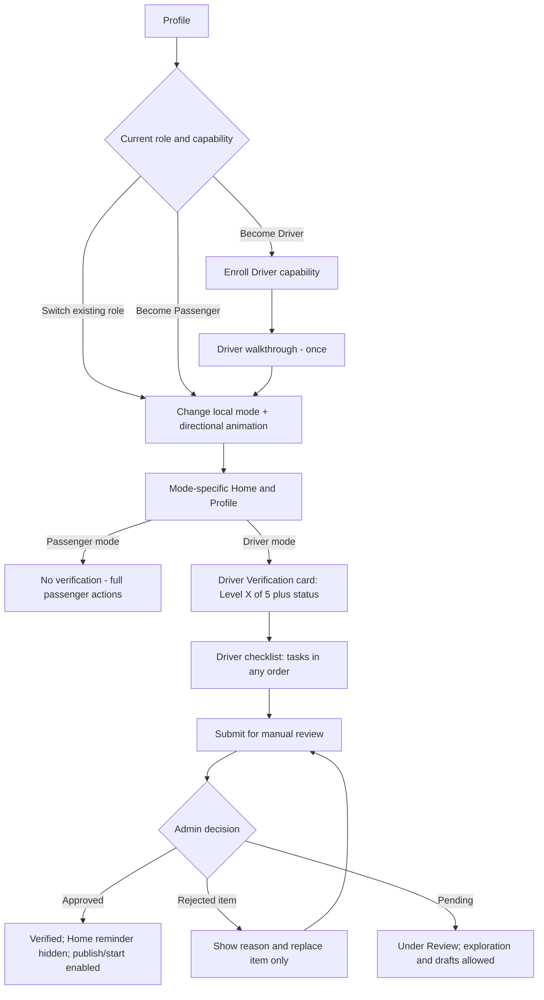

# RAFEEQ — Feature 02: Profile, Modes, Driver Verification — Backend Implementation Handoff v3

**Status:** Backend can begin now. **Scope:** mode/capabilities, profile, public profile, stats, driver documents, vehicle, organizations, safety preferences and administrative review interfaces.

## Final approved behavior
- One user account; Passenger/Driver capabilities. Both starts Passenger; switching mode instant and does not require OTP. `Become a Passenger` instant. `Become a Driver` enrolls capability and shows one-time Driver walkthrough.
- **No passenger verification**. Driver has **five checklist items** in any order: (1) ID front/back, (2) selfie, (3) licence, (4) vehicle registration, (5) vehicle details; **manual admin approval** after all required items. One vehicle in MVP.
- Driver may browse, see empty states and save commute drafts while unverified; **Publish** and **Start Commute** require approved active driver status, valid licence and eligible verified vehicle.
- Verified driver's approved selfie becomes avatar in both modes; passenger-only avatar uses initials. Public viewers see user name, permitted public profile information, rating/reviews/trip count, and **verified driver badge only when actually approved**; **never** see documents, ID images, DOB, private admin notes.
- **Latest user decision:** admin sets/edits document expiry when reviewing documents; backend validates expiry on every protected action, schedules notices, and preserves audit. Expired licence cannot be treated as legally valid even during administrative grace.
- **Latest user decision:** vehicle replacement = new **re-verification request**; no multi-vehicle switching. Keep old history; prevent new driving on unapproved replacement. Existing commute vehicle associations need integrity checks.
- **Latest user decision:** admin can restrict Driver only or whole Account, depending on issue. Restrictions can include publishing/start controls; account-wide restriction blocks both modes.
- **Latest user decision:** organization is searched/selected, then membership needs **document or other evidence** and admin/organization verification; selection alone never proves employment. Exact acceptable evidence is admin policy, not yet chosen.
- Profile stats separated per role: Passenger trips joined, rating, on-time; Driver trips driven, rating, on-time. Formulas defined below as recommended backend contract, subject to product signoff.
- Shared preferences: language (English MVP), dark mode, trusted contacts (max 3), privacy/blocks; mode-specific comfort preferences and payment/earnings entry placeholders.

## Suggested data entities
- `driver_profiles(user_id, verification_status, approved_at, suspended_at, current_vehicle_id)`
- `verification_items(id, user_id, kind, status, submitted_at, reviewed_at, reviewed_by, rejection_reason, expires_at, version)`; store secure object keys, not public URLs.
- `driver_verification_requests(id, user_id, type INITIAL|RENEWAL|VEHICLE_CHANGE|IDENTITY_CORRECTION, status, created_at, decided_at, decided_by)`; review individual items, retain approved items unless specifically invalidated.
- `vehicles(id, driver_id, make, model, color, plate, seat_capacity, registration_document_id, status, created_at)`; one active verified vehicle per driver.
- `organizations(id, name, status)`; `organization_requests(id, user_id, proposed_name, domain, status)`; `organization_memberships(id, user_id, organization_id, evidence_document_id, status, reviewed_by, reviewed_at)`.
- `user_comfort_preferences(user_id, mode, smoking, music, conversation, ac, ...)`; validate only agreed fields.
- `trusted_contacts(id, user_id, name, phone, created_at)` with max 3 constraint; shared across modes.
- `ratings` / `trip_participation` / `reliability_events` sourced from Feature 03, not duplicated in Profile DB.
- `moderation_restrictions` shared with Feature 01; `admin_audit` immutable.

## Proposed APIs
| Method | Path | Result |
|---|---|---|
| GET/PATCH | `/me/profile` | Private editable profile and permitted fields |
| GET | `/users/{id}/public-profile` | Public-safe fields, mode-specific stats, review summary, verified badge |
| POST | `/me/capabilities/driver` | Enroll driver, no automatic approval |
| POST | `/me/capabilities/passenger` | Enroll passenger instantly |
| GET | `/me/driver-verification` | 5 item statuses, counts, expiry, overall review state and allowed actions |
| POST | `/me/driver-verification/items/{kind}/upload-intent` | Secure upload grant for correct document type |
| POST | `/me/driver-verification/items/{kind}/submit` | Register upload, mark submitted/review pending |
| POST | `/me/driver-verification/submit-for-review` | Validate required items and submit |
| POST | `/me/vehicle-change-requests` | Begin re-verification of replacement vehicle |
| GET | `/me/stats?mode=passenger|driver` | Trips/rating/on-time with updated timestamp |
| GET/PATCH | `/me/comfort-preferences?mode=...` | Mode-specific settings |
| GET/POST/DELETE | `/me/trusted-contacts` | Manage <=3 contacts |
| GET | `/organizations?query=...` | Search |
| POST | `/organizations/requests` | Request missing org |
| POST | `/me/organization-memberships` | Select organization and submit evidence |
| GET | `/me/organization-memberships` | Membership status |
| POST | `/admin/driver-verifications/{id}/review` | Admin approve/reject items with reason, set expiry, decide final approval |
| POST | `/admin/restrictions` | Driver-only/account-wide suspension with reason and audit |

## State machines and enforcement
- Item: NOT_STARTED → UPLOADED → UNDER_REVIEW → APPROVED | REJECTED → REPLACED → UNDER_REVIEW. Approved can become EXPIRING/EXPIRED/RENEWAL_REQUIRED.
- Driver overall: NOT_STARTED → IN_PROGRESS → UNDER_REVIEW → VERIFIED | ACTION_REQUIRED; also EXPIRING, RENEWAL_REQUIRED, SUSPENDED. Overall VERIFIED only after explicit admin approval and all current mandatory items valid.
- Admin-entered expiry date is authoritative, validated against document and audited. Future renewal deadlines configurable; don't assume 30 days.
- Vehicle change starts a fresh vehicle-verification request, preserving trip history and prior document records. Determine handling of already-confirmed future commutes in admin operations; do not silently substitute unverified vehicle.
- Driver-only suspension must not invalidate passenger seat booking access; account suspension blocks both. Publish/Start endpoints must check server policy each call.
- Documents: encrypted private storage, time-limited admin upload/read access, malware/file checks, reviewer audit. Do not return raw private document URLs to other users.

## Statistics: recommended computable definitions (CONFIGURABLE / confirm before public release)
- `trips_joined`: number of passenger bookings with actual `COMPLETED` drop-off (not waiting list, pending, canceled, no-show).
- `trips_driven`: driver occurrences completed with at least one completed passenger booking; optionally count empty completed commutes separately.
- `rating_average`: average of currently active (not deleted) 1–5 reviews for that role, rounded for display; `rating_count`: active review count. No reviews => null and `New Driver` / `New Passenger`. Anonymous ratings still count.
- `on_time`: **suggested** numerator eligible pickups within configurable tolerance of agreed pickup time; denominator completed pickups with reliable GPS evidence. Driver and passenger metrics must be calculated separately. Exclude validated platform/GPS failures and successful disputes. **Tolerance, denominator exclusions and passenger punctuality definition remain product decisions**; expose metric version and counts to avoid silently changing scores.
- Recompute aggregates on review edit/delete and dispute resolution, or use idempotent incremental projections.

## Acceptance / edge cases
- Passenger can book without ID verification; Driver cannot publish/start before admin approval.
- Driver checklist can be completed in any order; rejecting one item doesn't delete other approvals.
- Approved selfie used as avatar; public profile never leaks private documents.
- Admin can set expiry, reject with reason, renew, suspend driver only or entire account; protected endpoints reflect latest state.
- Replacement vehicle requires fresh approval and doesn't overwrite historic vehicle snapshot.
- Organization selection remains unverified until evidence reviewed.
- No rating returns null/new, not 0 stars.

## Dependencies / pending decisions
Review SLA, accepted organization evidence types, document-expiry grace, exact on-time formula, public review moderation, suspension appeal, payout provider and payment method. Backend can implement states and configurable fields now.

## Delivery contract for backend engineer and AI coding agent
- These files specify **product behavior and proposed API contracts**, not proof that any endpoint/database already exists. Inspect the existing code, migrations and `RAFEEQ_MOBILE_API_GUIDE.md` first; reuse compatible conventions, do not duplicate APIs.
- Server owns authorization, eligibility, prices, capacity, times, transitions, and conflict resolution. Mobile is never authoritative. All mutations require authenticated identity, authorization, validation, idempotency where applicable, and structured error codes.
- UTC timestamps in persistence, Egypt-local calendar/day semantics in scheduling; store IANA timezone and expose ISO-8601 timestamps. Define explicit occurrence IDs for recurring rides.
- Enforce relational constraints, audit sensitive changes, avoid exposing documents/phones/location to unrelated users, use transactional outbox for notifications, and tests for concurrency/retries.
- Fields/endpoints below are **proposals**; adapt to established repository conventions while preserving behavior.
- **Do not invent pending business rules.** Implement configurable policy keys and documented TODOs for pricing, fee amounts, payment processor, regulatory/legal and admin operations.
- Source of truth: latest user decisions in conversation > Feature 01/02/03 Claude Design v2 > prior Product/Backend documents. The v2 file is included below as a source appendix. If conflicts remain, log them; do not silently implement outdated policies.

---

# Appendix: Exact Claude Design v2 reference (historical, superseded by v3 overrides above where conflicting)

# RAFEEQ — Feature 02: Profile, Modes, Preferences & Verification
## Final Claude Design Handoff — v2 (updated after design review)

**Status:** Final for agreed MVP UX. Preserve the existing Profile screenshot's visual identity; implement the updates below. See companion Product/Backend handoff for permissions, backend and edge cases.

> **What changed in v2:** Verification is **Driver-only**. Passengers have **no** verification checklist, card or Home reminder. The Driver checklist is a single list of **5 levels** (`Level X of 5`). The profile header was simplified (no big outlined switch button; a compact Passenger | Driver segmented switcher only when both capabilities exist). `Both` starts in Passenger mode. A verified Driver sees **no** Home reminder at all. No women-only claims anywhere; women-only is a trip-level option set by a woman driver (Feature 03). English only for now; Arabic/RTL later. All changes are marked **[v2]**.

## 1. Existing Profile reference
The supplied design has a teal initials avatar, name and badge, Passenger/join-date/area subtitle, outlined `Switch to Driver`, three stats cards, a blue-tinted `Verification · Level 2 of 4` card, Preferences and Account lists, and Home / Discover / center + / Trips / Profile bottom navigation. **Do not redesign it from scratch.**

**[v2]** Keep the identity (avatar, name, subtitle, three stats, grouped rows, bottom navigation). Replace the outlined `Switch to Driver` button with the compact mode switcher in §2. The verification card appears **only in Driver mode** and reads `Level X of 5`.

## 2. Profile states and header
- Keep name/avatar/role subtitle/mode switch; initial name is a **single free-form full-name field**, accepting `Sara` or `Sara Ahmed`.
- **[v2] Header layout:** avatar, full name, subtitle `Joined Mar 2025 · New Cairo`. No role word in the subtitle; the active mode is shown by the switcher.
- Before identity verification show initials; after approval show approved verification photo. No ordinary edit-photo control. Identity correction opens a controlled re-verification flow.
- **[v2]** Once a Driver's identity is approved, the verified photo replaces initials in **both** modes (Passenger and Driver). A Passenger-only account always shows initials.
- **[v2] Mode switcher:** a compact segmented `Passenger | Driver` control under the header, shown **only** when the account has both capabilities. The Driver segment carries a small warning dot when Driver verification needs action.
- **[v2] Contextual CTA cards** instead of the outlined button:
  - Passenger-only account: `Become a Driver` card → enrol Driver capability → walkthrough (§5) → Driver Home.
  - Driver-only account: `Become a Passenger` card → **instant**, no verification, no walkthrough.
- Switching an already enrolled mode is immediate and local; display mode-specific Home, statistics and verification. It must not imply approval.
- **[v2] Switch animation:** directional slide (Passenger → Driver slides one way, Driver → Passenger the other) with a short toast: `Switched to Driver mode` / `Switched to Passenger mode`. The same switch is available as a chip on Home (Feature 03).
- Badge only when a clearly defined approval state supports it; avoid implying OTP alone means verified. **[v2]** Show the `Verified driver` badge only in Driver mode after admin approval.

## 3. Mode-specific statistics
Keep exactly three cards, updating by mode:

| Passenger | Driver |
| --- | --- |
| Trips joined | Trips driven |
| Passenger rating | Driver rating |
| Passenger on-time | Driver on-time |

New mode: `0` trips and `—` for rating/on-time. Design loading, offline, error and populated states. Never merge role statistics.

**[v2]** Loading = skeleton shimmer on the three cards. Offline = last known values + `Offline · showing last update`. Error = `Couldn't load stats` + `Retry`. Rating/on-time formulas are still undecided (see Open Items).

## 4. Verification card — Driver only [v2]
**Do not remove `Level X of Y`!** **[v2]** The card exists **only in Driver mode**, as `Driver Verification · Level X of 5`. It shows **level, status and steps once**, e.g. `Level 3 of 5 · In progress` with a one-line steps hint (`Licence and vehicle details left`) and a `Continue →` link.

- **[v2]** Passenger mode shows **no** verification card. Passengers can request seats, join waiting lists and create demands without any ID upload.
- Driver mode shows **Driver Verification** and Driver progress/status.
- Keep Profile card prominence; also show the Driver reminder **directly below Driver Home AppBar** (§15 of Feature 01 v2).
- Tapping opens the Driver checklist.
- Checklist tasks can be completed **in any order**. Show item states: Not started, Uploaded, Under review, Approved, Rejected (with reason), Renewal required.
- Overall role states and copy: `Not started` / `In progress` / `Under review` / `Verified` / `Action required` / `Expiring` **[v2]** / `Renewal required` / `Suspended`.
- Completing all tasks does **not** mean approved until manual admin approval.
- When a document is rejected, highlight **only the rejected item**, explain the reason and offer `Replace document`. Preserve approved items.
- **[v2]** After approval: Profile card shows `Verified` (compact, green). The Home reminder is **hidden completely**. It returns only for Expiring, Renewal required or Suspended.

### Passenger checklist [v2 — removed]
Passengers have **no** verification. Remove the Passenger checklist, the Passenger verification card and the Passenger Home reminder. Phone OTP from Feature 01 is the only passenger trust step.

### Driver checklist [v2 — 5 levels]
1. Government ID front and back
2. Selfie / face photo (becomes the verified profile photo)
3. Driving licence
4. Vehicle registration
5. Vehicle details (make/model/color/plate)

Then **manual admin approval** (not counted as a level; shown as status `Under review`).

**One vehicle per Driver in MVP.** If user changes vehicle, show new vehicle verification requirements. Use actual backend-configured checklist counts in the card, not hardcoded universal levels.

**[v2] Unverified Driver can explore:** browse Driver Home, see Requests/Commutes empty states, and fill the create wizard as a draft. `Publish` and `Start Commute` open a gate sheet: `Finish verification to publish` + `Continue verification`.

## 5. First-time Driver mode illustrated walkthrough
Show **once** on first activation of Driver mode (whether chosen at onboarding or added later), after capability enrollment and before Driver Home. User can **Skip** and continue; walkthrough is not verification.

Suggested four pages, each with a friendly illustration, arrow-led visual story, one title, one short description, progress dots, `Back`, `Next`, `Skip`, and last-page `Get Started`:
1. **Create your commute** — set route, time and available seats.
2. **Manage requests** — review passenger requests and confirmations.
3. **Drive your route** — follow trip progress and supported sharing/safety features.
4. **Build trust** — ratings and reliable trips.

Design as a compact full-screen onboarding stepper or modal sheet that fits mobile screens. After Skip/Get Started: Driver Home with the Driver verification reminder. If unverified, publishing CTA opens verification requirements.

**[v2]** Each page has an animated illustration (route line drawing, cards sliding, car moving along the route, stars filling). Initial role `Both` does **not** show the walkthrough at onboarding; it shows on the first switch to Driver.

## 6. Preferences and Account rows
Keep the visual groupings and row styles from the supplied screenshot.

### Preferences
- **Language**: Arabic / English; one shared setting. **[v2]** English only for now; the row shows `English` and `Arabic — coming soon`. Keep layouts RTL-ready.
- **Dark mode**: one shared setting.
- **Comfort & atmosphere**: one entry but **different content by active mode**. Passenger: desired environment; Driver: conditions offered/allowed. Illustrative fields: smoking, music, conversation, AC. Avoid claiming these are strict filters until matching rules are defined.
- **Trusted contacts & safety**: **shared contacts** across Passenger/Driver; show count; opens safety center and trip-sharing options. **[v2]** Up to 3 contacts, `Add contact` and remove.
- **Payment methods** in Passenger mode: payment methods for trips. **[v2]** Cash default + `Add card` placeholder.
- **Payment & Earnings** in Driver mode: payout methods and earnings history. Design entry states without inventing a live payment provider. **[v2]** Two states: new driver (`Earnings appear after your first commute`) and active driver (`Earnings · October` total, history list, `Payout method` with `Payout provider to be confirmed`).

### Account
- **Government ID**: read-only status and Verification Centre deep-link; no free edit. **[v2]** In Passenger-only mode the row reads `Not needed` (or is hidden); in Driver mode it shows the ID item status.
- **Driver documents**: show for Driver capability/active mode; link to licence, registration and vehicle checklist; do not require in Passenger-only mode.
- **Organization**: optional **search-and-select**, request missing organization, and display membership status. Selecting an organization does not confer verified membership. **[v2]** Four states: search, request missing (name + email domain form), selected (`Membership not verified`), requested (`Request sent · we'll notify you`).
- **Privacy & blocked users**: shared account settings.
- **Help & legal**: policies, support, consents.
- **Log out**: clear action near bottom, confirmation dialog.

## 7. Renewal and admin suspension UI
- Before expiry: reminder with document name and expiry date. **[v2]** Status `Expiring` (amber) on card, checklist item and Driver Home reminder.
- On expiry: `Renewal required`, configured deadline, `Upload renewed document` CTA, and clear explanation of current restrictions.
- Grace duration is **admin-configurable and not yet chosen**. Never show a hardcoded 30-day deadline.
- **Do not visually imply that an expired licence is valid for driving during grace.** The grace allows document correction/account access; legally restricted actions stay blocked.
- Admin Driver suspension: show a distinct high-visibility `Driver access suspended` state, reason if shareable, and next steps. Upcoming commutes display `Temporarily suspended`; notify affected passengers. Do not auto-cancel or auto-reactivate. Passenger mode remains usable unless account/shared identity is affected.

## 8. Verification notifications
Both push and in-app notifications. Design notification rows for submission, under review, approved, rejection with reason, expiry warning, deadline reminder and suspension. Tapping opens correct role/checklist item. The app refreshes current status from backend.

**[v2]** All verification notifications are Driver notifications. Passengers never receive verification notifications.

## 9. Navigation flows

## 10. Screens Claude should produce/update
1. Profile Passenger (Passenger-only, Passenger mode of a Both account, verified photo after driver approval), including initials/avatar. **[v2]**
2. Profile Driver Not started, In progress, Under Review, Action required, Verified, Expiring, Renewal Required, Suspended. **[v2]**
3. Profile mode-specific stat variants, loading, offline, error and empty states.
4. First-time Driver illustrated stepper: four pages plus Skip/Back/Next/Get Started.
5. ~~Passenger checklist~~ **[v2] removed.** Passenger Government ID row shows `Not needed`.
6. Driver checklist (5 levels) in every overall state: Not started, In progress, All uploaded, Under review, Action required, Verified, Expiring, Renewal, Suspended. **[v2]**
7. Document capture (ID), uploading, selfie, vehicle details, rejection reason, replace-one-item, approved, renewal upload and identity correction/re-verification screens.
8. **[v2]** Driver Home verification reminder directly below AppBar for each Driver state (hidden when Verified).
9. Passenger/Driver Comfort & atmosphere settings.
10. Shared Trusted Contacts & Safety.
11. Passenger Payment Methods and Driver Payment & Earnings entry screens (new driver + active driver). **[v2]**
12. Organization search/select/request missing and membership status (4 states). **[v2]**
13. Verification in-app notification list and deep-link destinations.
14. Logout confirmation and standard loading/error/offline states.
15. **[v2]** Become a Driver / Become a Passenger cards and the mode-switch animation + toast.

## 11. Guardrails and deferred details
- Do not create two accounts, force OTP on mode switch, allow unapproved publishing, or automatically approve after completing a checklist.
- **[v2]** Do not ask passengers for any verification before requesting a seat, joining a waiting list or creating a demand.
- Do not require duplicate approved ID/selfie or restart all verification for one rejected document.
- Do not make the verified photo casually editable or display private ID/DOB publicly.
- Do not make RAFEEQ women-only. **[v2]** Women-only is a per-commute option that **only a woman driver** can set; everyone can see it and the Discover filter narrows to it (Feature 03).
- **[v2]** No Arabic/RTL screens yet; keep layouts mirror-ready.
- Leave unspecified: exact renewal duration, public name/badge policy, women-only eligibility checks, precise comfort filters, payment processor, rating/on-time formulas. Use neutral placeholders instead of inventing policy. **[v2]** SOS behavior and the center + button are now defined in Feature 03 v2.

## 12. Reference asset
**Driver tutorial visual reference:** `a_clean_product_ui_mockup_image_showing_a_multi_st.png` (keep this PNG alongside the Markdown when sharing with Claude Design).

**[v2] Prototype reference:** the RAFEEQ Design canvas holds every Feature 02 state as a separate artboard (`P2-01` … `P2-71`): Profile states, Driver checklist states, document flows, Driver Home reminders, Comfort, Contacts, Payments, Organization and verification notifications.
